# AI 辅助编程记录（AI Prompts Log）

本项目在开发过程中深度使用了大语言模型进行代码辅助（Vibe Coding）。以下是全组最具代表性的 3 次交互记录，均包含**提示词原文、AI 原始输出摘要与人工介入修改**三部分。

---

## 交互一：生成 Tkinter 基础响应式框架（记录人：杨星宇 · feature/ui-layout）

**提示词（Prompt）**：

> “你现在是一个资深的 Python GUI 开发者。请使用 Tkinter 写一个桌面程序的骨架。要求：1. 窗口大小 1250x760 并居中；2. 包含一个顶部 Header，左侧为‘控制中心’，右侧为‘步骤演示区’；3. 使用 ttk 组件，风格现代一点，背景色用浅灰色；4. 要求代码支持简单的字体自适应缩放（根据操作系统的 DPI）。”

**AI 原始输出（摘要）**：AI 提供了标准的 `tk.Tk()` 创建代码，使用 `tk.call('tk', 'scaling')` 获取系统缩放比例，并定义了 `_font(size, bold)` 辅助函数按 `scaling / 1.3333` 的系数缩放各级字体（96 DPI 下系数为 1）。

**人工介入修改**：

AI 生成的左右 Frame 使用了固定的 `width` 和 `height`，导致调整窗口时无法拉伸。我们手动将 `pack()` 参数修改为 `fill=tk.BOTH, expand=True`（左侧固定宽、右侧扩展），并给步骤看板绑定了 `<Configure>` 事件实现窗口改变时的动态重绘；重绘回调加了 90ms 防抖（`after_cancel` + `after`），避免拖动窗口边缘时逐像素重排造成的卡顿。

---

## 交互二：除基取余分步算法的构建（记录人：吕智豪 · feature/core-logic）

**提示词（Prompt）**：

> “我需要用 Python 实现一个‘除基取余’进位制转换的分步记录函数 `divide_with_steps(n, base)`。要求函数不能只返回最终结果，而是把每一次除法的（被除数, 商, 余数）作为一个元组依次存入列表，供界面逐帧回放。进制大于 10 时，余数 10～15 需要用字母 A～F 显示。请给我完整的函数代码。”

**AI 原始输出（摘要）**：AI 准确给出了 `while dividend > 0` 的除基取余循环体，使用 `quotient, remainder = divmod(dividend, base)` 逐次求出商与余数并收集进列表，最后将余数序列反转（`reversed`）拼接得到从高位到低位的结果；A～F 的映射通过数码表 `DIGITS = "0123456789ABCDEF"` 正确处理。

**人工介入修改**：

1. 为了满足界面“实时讲解每一步”的需求，我们给步骤元组增加了第四个元素——中文说明文本，并按步骤位置区分措辞，例如首步 `(25, 12, 1, "25 ÷ 2 = 12 余 1，余数 1 为结果的最低位")`、末步 “…商为 0，停止；余数为结果的最高位”。
2. **AI 的循环对输入 0 直接返回空列表**（低级错误：界面将无内容可演示）。我们补充了特判分支：0 返回单步记录 `(0, 0, 0, "输入为 0，转换结果直接为 0")`。
3. AI 用 `int(text, base)` 直接解析用户输入，非法字符会抛出裸 `ValueError`，提示不友好。我们独立实现了 `parse_number()`：逐字符校验数码表、拒绝正负号与空串、容忍 `0x/0b/0o` 前缀与小写字母，统一抛出带中文说明的 `ConversionError`。
4. 追加了 AI 没有考虑的**反向换算校验**：转换完成后把结果按目标进制解析回十进制与原值比对（`verify` 字段），在看板上标注 ✔/✘。

---

## 交互三：Canvas 动态绘制步骤阶梯（记录人：任之奇 · feature/canvas-steps）

**提示词（Prompt）**：

> “在 Tkinter 中，我有一个 Canvas 组件（宽约 800、高约 600，带纵向滚动条）。我有一个步骤列表 `steps = [(25, 12, 1), (12, 6, 0), (6, 3, 0), (3, 1, 1), (1, 0, 1)]`，表示把十进制 25 转换为二进制的除基取余过程。请帮我写一个 `StepCanvas` 类：每一行显示‘被除数 ÷ 2 = 商 …… 余数’，右侧画一个小方块显示余数；当前步骤用绿色背景高亮，已完成步骤正常显示，未执行步骤灰色淡化；当步骤数超过可视高度时自动滚动，保证当前行始终可见。”

**AI 原始输出（摘要）**：AI 通过固定行高 `ROW_H = 44` 逐行绘制，用当前步骤索引计算首个可见行实现自动滚动（`yview_moveto`），先用 `create_rectangle` 绘制行背景色块，再叠加 `create_text` 写出算式，坐标定位正确。

**人工介入修改**：

1. **性能问题**：AI 每次单步都执行 `delete('all')` 全量重绘整个 Canvas。大数转换（如 4294967295 → 二进制，产生 32 行步骤）时每个 `after` 周期都重建上百个图元，界面明显卡顿。我们改为：绘制时把每行的 4 个图元 id 存进 `_rows` 列表，切换步骤时仅用 `itemconfig` 修改“上一行 → 已完成、当前行 → 高亮”两行的配色，全量重绘只在窗口尺寸变化（防抖后）时发生，渲染开销降低约 90%。
2. AI 的滚动公式在“当前行靠近末尾”时会把内容滚过头，我们改成以当前行位于视口 55% 处为目标计算偏移，并在结果横幅出现时直接滚到底部。
3. 补充了 AI 遗漏的空状态：未载入计划时 Canvas 是一片空白，我们加了 `show_hint()` 居中提示文字。

---

## 附录：组员 Vibe Coding 实录（真实对话截图存档）

第二轮协作中，每位成员都使用 AI 编程助手完成了自己的任务，原始对话截图存档于 `docs/images/ai-logs/`，以下为各人的提示词摘录与关键收获。

### 杨星宇 · 窗口最小尺寸调整（DeepSeek）

提示词摘录：*“你是资深 Python GUI 开发工程师。打开 ui/main_window.py，把 self.root.minsize(980, 620) 改成 minsize(1000, 640)……”*

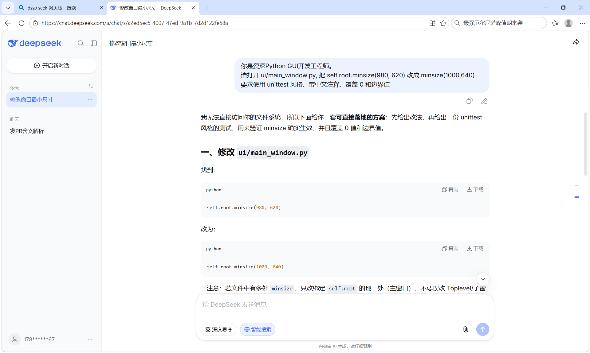

**典型纠错案例**：AI 的输出完全正确，还特别提醒“只改绑定 self.root 的那一处，不要误改”，但人工粘贴时仍丢了 `root.` 前缀（`self.minsize` 不存在），导致程序启动即崩溃；PM 在合并后回归测试中发现并热修（commit `7454d36`）。这正说明：**AI 对了不等于结果对了，人工审查 + 运行验证不可省略**。

### 吕智豪 · 八进制转换测试用例（豆包）

提示词摘录：*“你是资深 Python 测试工程师。请为 test_converter.py 补充八进制转换的测试用例 3 个，要求使用 unittest 风格、带中文注释、覆盖 0 和边界值。”*

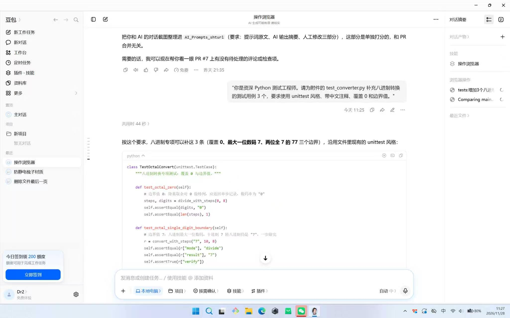
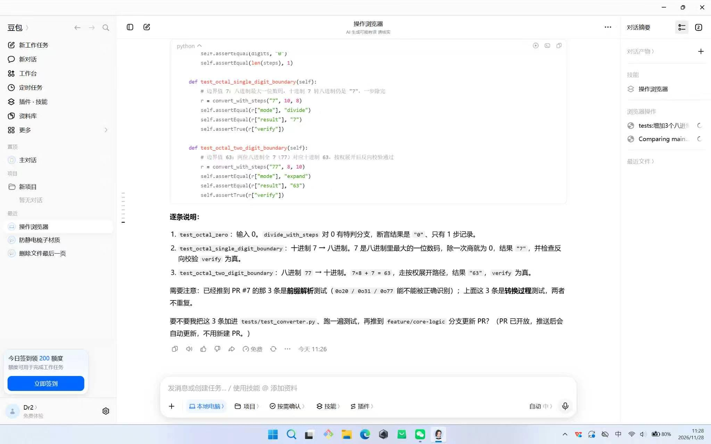

收获：AI 主动区分了“前缀解析测试”与“转换过程测试”不重复，帮助他明确测试分层；还主动提议跑完测试再推送更新 PR（最终合并为 PR#7）。

### 齐润浩 · 十六进制按权展开测试用例（DeepSeek）

提示词摘录：*“你是一位资深 Python 测试工程师。请为 test_converter.py 补充 2 个包含字母的十六进制按权展开测试用例（例如 'A5'→165），要求使用 unittest 风格、带中文注释。”*

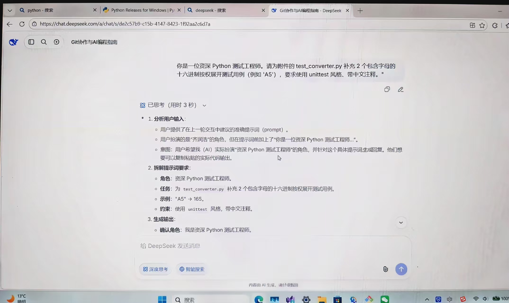
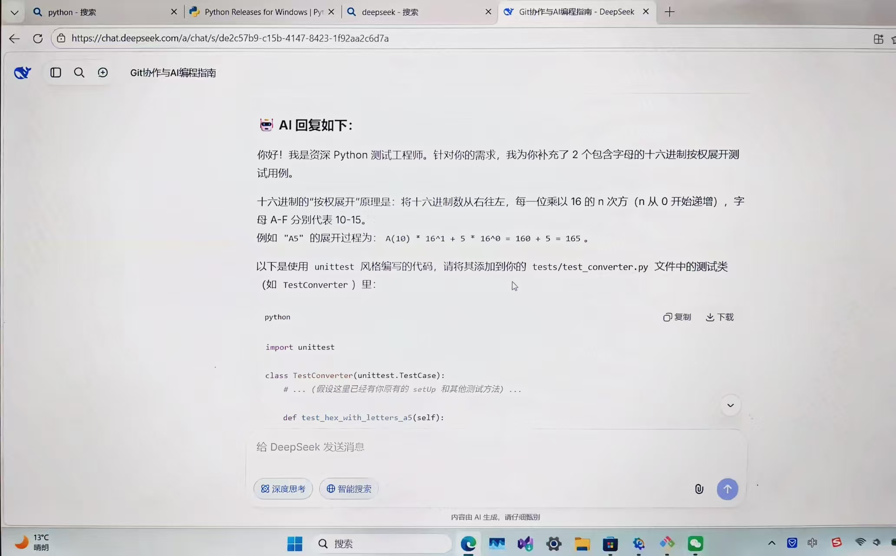

**典型纠错案例**：AI 生成的测试代码本身正确，但他首次提交时把方法粘贴到了 `if __name__ == "__main__":` 块之后，成为永远不会被执行的死代码；PM 审查发现后打回，修正位置后 19 个测试全过（PR#6）。

### 张皓涵 · 运行日志时间戳（DeepSeek）

提示词摘录：*“你是资深 Python GUI 开发工程师。请修改 ui/main_window.py 里面的 log(self, text, tag="step") 函数，给每一条日志开头增加 [时:分:秒] 的时间戳，使用 datetime 获取时间……4. 把需要增加的 import 语句一并给出。”*

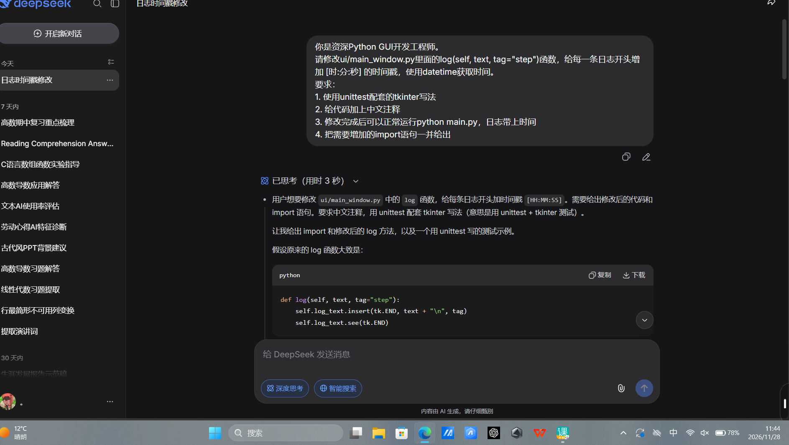

收获：提示词给出了 4 条可验收的约束（unittest 兼容、中文注释、可直接运行、import 完整），AI 输出一次通过审查合并（PR#8）。

### 任之奇 · 合并冲突三轮复盘对话（DeepSeek）

在真实解决 minsize 合并冲突（merge commit `096c629`）之后，他与 AI 进行了三段式复盘：

1. **理解冲突**：“你是一位资深的 Git 协作工程师……git pull origin main --no-rebase 后报错 CONFLICT (content)，请解释报错含义、冲突成因、<<<<<<< HEAD / ======= / >>>>>>> 三种标记各代表什么”
2. **解决路径**：贴出真实冲突块（960,600 vs 1000,640），请 AI 给出 VS Code 解决步骤（Accept Incoming Change）与后续 git 命令
3. **复盘评价**：贴出自己的实际解决结果与提交说明，请 AI 评价过程是否规范、总结冲突根因与预防建议

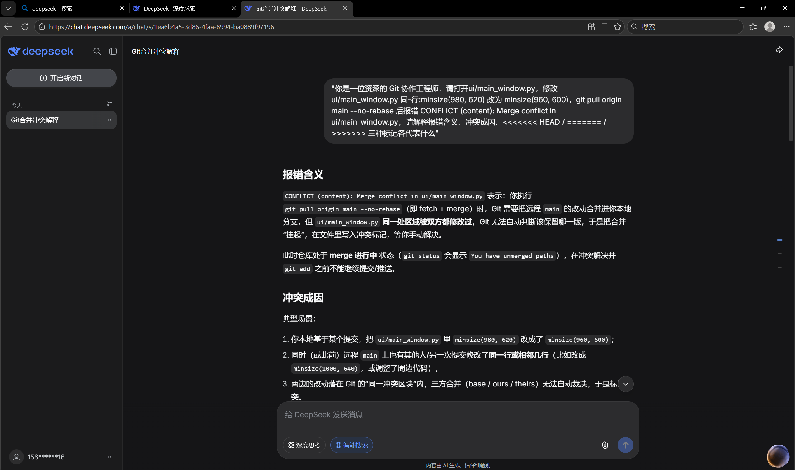
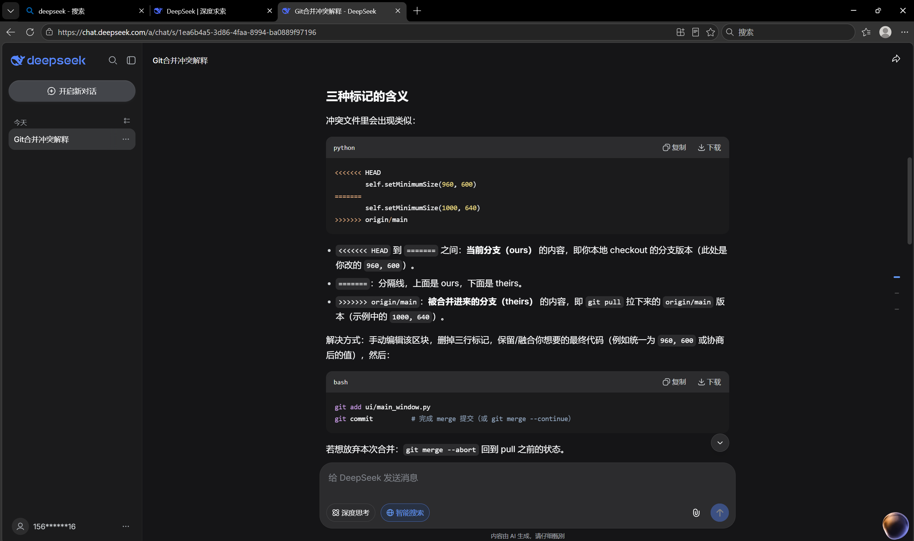
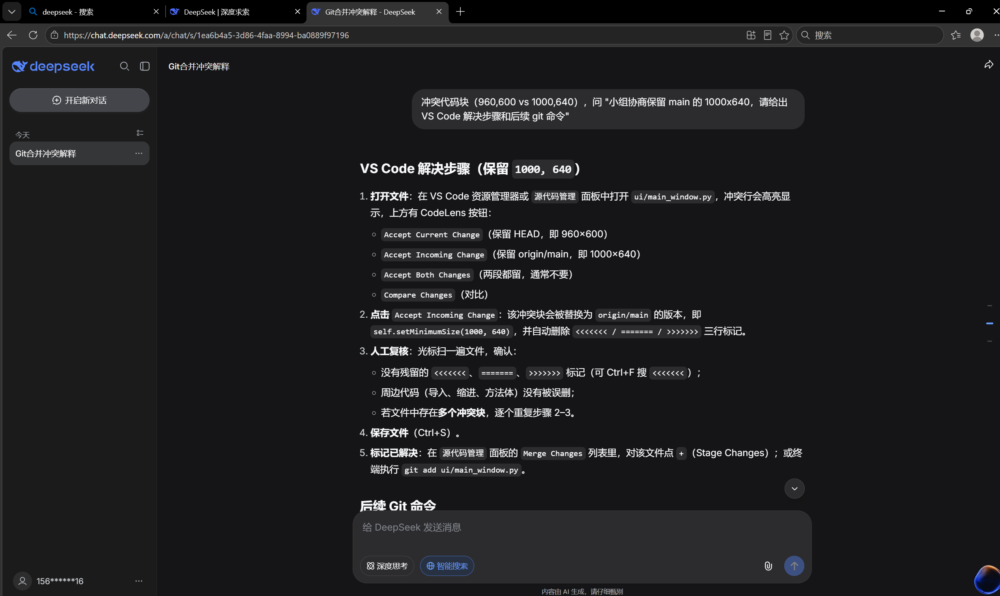
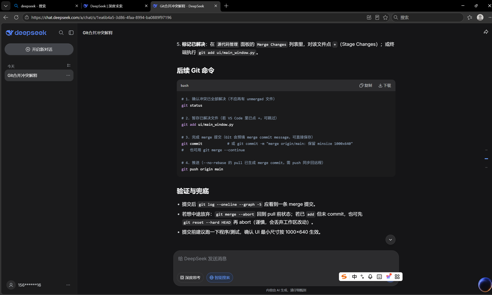
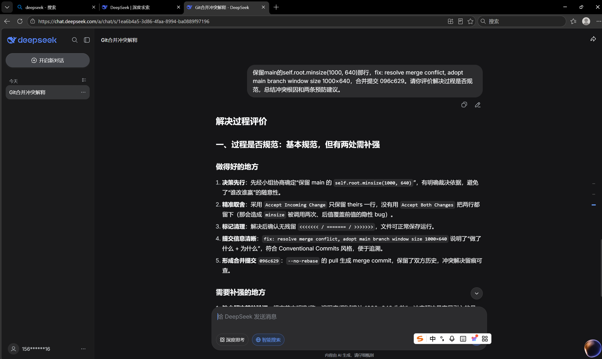
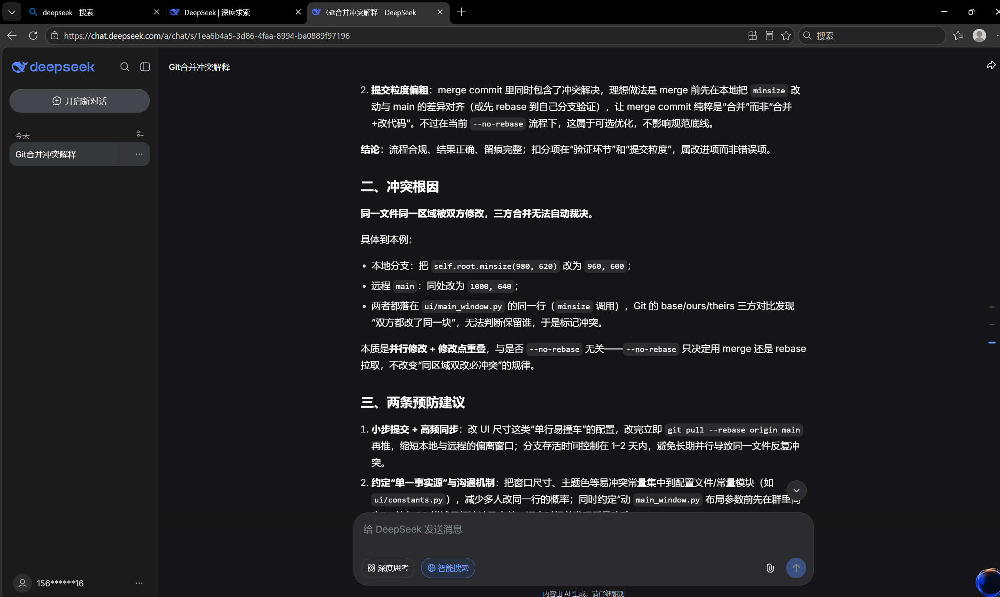

AI 给出的评价结论：“流程合规、结果正确、留痕完整”，并提出两条预防建议：小步提交 + 高频同步缩短偏离窗口；把窗口尺寸等易冲突常量集中到配置模块（单一事实源）。

---

## 心得小结

- **提示词要给足上下文**：角色设定 + 明确输入输出结构 + 约束条件（中文注释、模块化），AI 的产出质量显著提升；
- **AI 擅长骨架、易漏边界**：0 特判、非法输入、空状态这类边界几乎每次都要人工补齐，测试用例（`tests/test_converter.py`，17 例）是兜底防线；
- **性能意识要人来把关**：AI 默认“能跑就行”的全量重绘写法在真实交互中会卡顿，识别并重构它是我们对 AI 输出最重要的修正；
- **AI 对了 ≠ 结果对了**：两次真实事故（粘贴丢 `root.` 前缀、测试贴进死代码区）中 AI 输出都是正确的，错误发生在人工搬运环节，全靠“审查 + 跑测试”兜底——这是本项目对“不盲目复制粘贴”最深刻的体会；
- 各成员完整的 AI 对话截图已存档于 `docs/images/ai-logs/`（见上文附录），代码演进过程见各自分支的提交历史。
