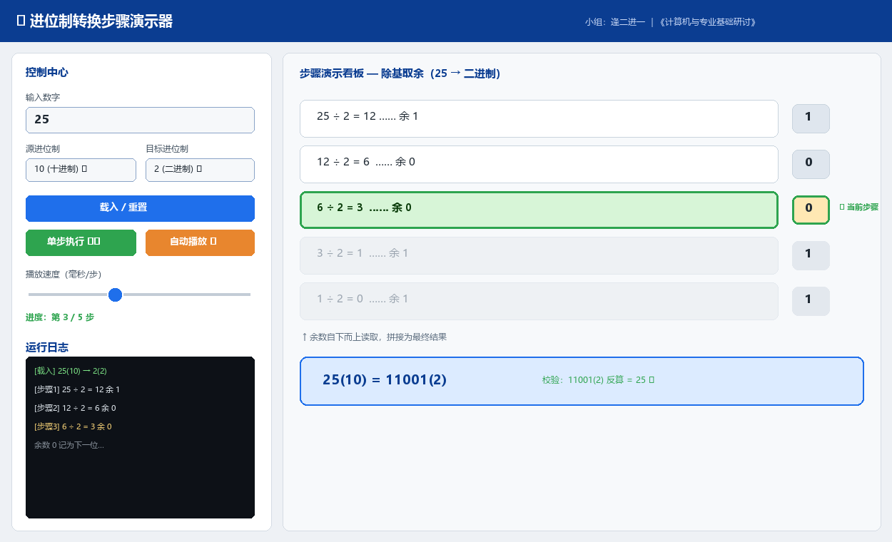

# 进位制转换步骤演示器：除基取余与按权展开可视化项目需求与设计文档

**项目组**：逢二进一　｜　**代码仓库**：[jjj3851/computer-intro-project](https://github.com/jjj3851/computer-intro-project)

## 一、项目背景与目标

在《计算机与专业基础研讨》的学习中，进位制转换（二进制、八进制、十进制、十六进制之间的相互转换）是理解计算机内部数据表示的基石，但“除基取余”与“按权展开”的运算过程常常因为过于抽象、只能死记硬背步骤而难以真正掌握。本项目旨在开发一款轻量级桌面演示程序，将进位制转换中的每一次除法运算、余数提取与权值累加进行可视化分步展示，帮助初学者直观理解不同进位制之间转换的本质。

## 二、核心功能需求

本项目围绕 “十进制与二 / 八 / 十六进制的相互转换” 这一经典案例，需实现以下核心功能：

1. **除基取余步骤可视化**：动态展示“被除数 ÷ 基数 = 商 …… 余数”的除法阶梯，当前步骤绿色高亮、已完成步骤正常显示、未执行步骤灰色淡化，余数按“自下而上”顺序汇总为最终结果。其数学依据是：任意正整数 N 都可唯一表示为 N = 商 × 基数 + 余数（0 ≤ 余数 < 基数），反复执行该除法直到商为 0，将余数逆序读取即得目标进制数码串。
2. **按权展开追踪**：目标进位制为十进制时，右侧面板需完整展示每一位数码的权值展开式（如 `1×2⁴ + 1×2³ + 0×2² + 0×2¹ + 1×2⁰`），并在运行时逐项实时高亮累加过程。
3. **执行控制台**：
   - 支持用户自定义输入任意非负整数，并选择源进位制与目标进位制（2 / 8 / 10 / 16）。
   - 支持单步执行与可调速的自动播放功能。
   - 自动播放延迟范围 100～2000 毫秒/步，由控制中心滑块调节（左慢右快），播放中可随时暂停与继续。
4. **运行日志面板**：实时记录每一步的除法运算（如 `25 ÷ 2 = 12 … 1 ➔ 余数 1 记为最低位`），并对**最终转换结果**与**反向换算校验**进行醒目标注。

## 三、界面设计参考

本系统采用 Python 的 `tkinter` 库进行构建，整体分为左右两大模块。左侧为控制台与输入区，右侧为步骤演示看板（除法阶梯 / 按权展开式）。界面高保真原型参考图如下：



“除基取余”文字示意（25 → 二进制）：

```text
  25 ÷ 2 = 12 …… 余 1   ← 最低位
  12 ÷ 2 =  6 …… 余 0
   6 ÷ 2 =  3 …… 余 0
   3 ÷ 2 =  1 …… 余 1
   1 ÷ 2 =  0 …… 余 1   ← 最高位
  余数自下而上读取：25(十进制) = 11001(二进制)
```

（注：上图为“除基取余”步骤阶梯概念示意图，实际界面采用现代化扁平设计。）

## 四、团队分工协作表

| 姓名 | 学号 | 组内角色 | 任务分工 |
| ---- | ---------- | -------------- | -------- |
| 焦铭韬 | 2610250714 | 项目经理 | 项目管理与统筹：团队进度把控、Git 协作规范制定、代码合并、撰写 README |
| 杨星宇 | 2610251098 | UI/UX 交互设计师 | 界面设计与交互：绘制系统 UI 原型、设计窗口自适应布局与样式 |
| 吕智豪 | 2610250869 | 算法工程师 | 核心算法与推导：除基取余分步算法实现、按权展开法规则设计与算法推导 |
| 齐润浩 | 2610250145 | 算法工程师 | 核心算法与推导：除基取余分步算法实现、按权展开法规则设计与算法推导 |
| 任之奇 | 2610250791 | 算法工程师 | 核心算法与推导：除基取余分步算法实现、按权展开法规则设计与算法推导 |
| 张皓涵 | 2610251159 | 算法工程师 | 核心算法与推导：除基取余分步算法实现、按权展开法规则设计与算法推导 |

## 五、修订记录

| 版本 | 日期 | 修订人 | 修订说明 |
| ---- | ---------- | ------ | -------- |
| v0.9 | 2026-11-20 | 焦铭韬 | 初稿：项目背景与目标、核心功能需求、界面概念示意、团队分工协作表 |
| v1.0 | 2026-11-21 | 焦铭韬 | 按作业规范重命名文件；新增界面高保真原型参考图；补充仓库链接与修订记录小节 |
| v1.1 | 2026-11-21 | 全体组员 | 分组协作完善：补充除基取余数学依据（吕智豪 PR#1）、自动播放调速细节（齐润浩）、看板自动滚动说明（任之奇 PR#3）、补全贡献者 GitHub 用户名（杨星宇）、新增运行常见问题（张皓涵 PR#4） |
| v1.2 | 2026-11-23 | 焦铭韬 | 教师选题审核**通过**，无修改意见；进入代码开发与团队协作阶段 |
