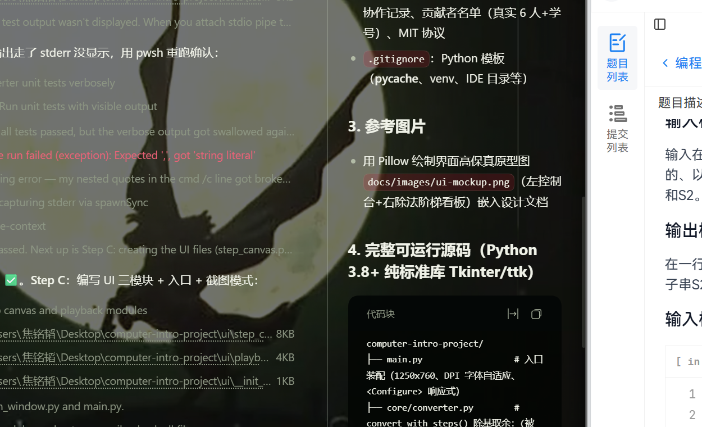
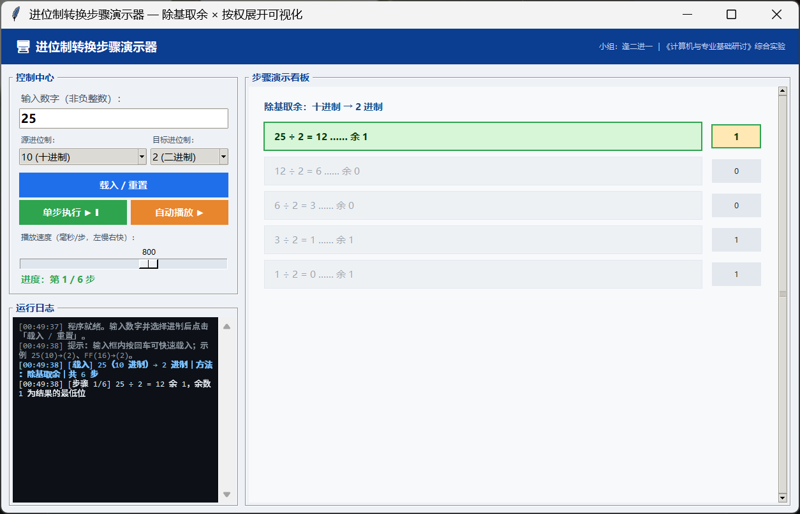
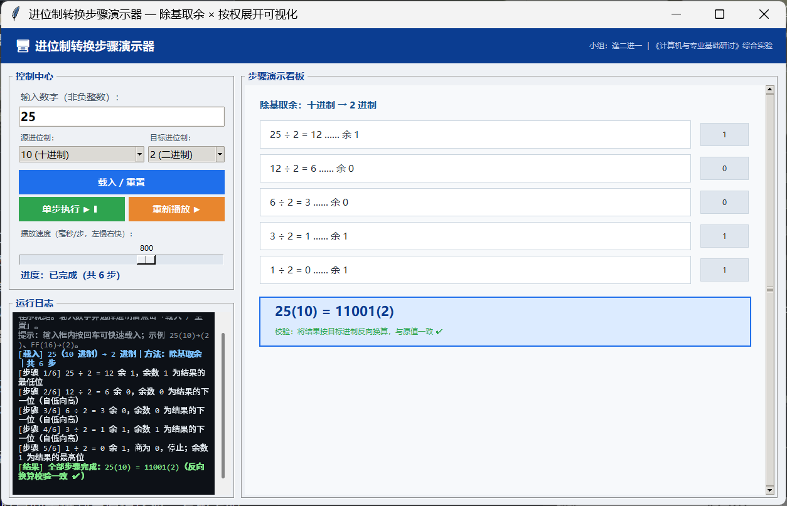

# 🖥 进位制转换步骤演示器（Radix Conversion Step Demonstrator）

把“除基取余”与“按权展开”逐步可视化 ——《计算机与专业基础研讨》大作业演示程序。

**项目组**：逢二进一　｜　**技术栈**：Python 3.8+ · Tkinter（纯标准库，零第三方依赖）

## 一、项目简介

本项目通过 Python 的 Tkinter 图形库，完整演示进位制转换（二进制、八进制、十进制、十六进制相互转换）的底层原理与计算过程：每一步除法运算、每一个余数的读取顺序、每一位数码的权值累加，都在右侧看板上逐帧高亮展示，并配有实时运行日志与反向换算校验，帮助初学者直观理解计算机中不同进位制之间的转换机制。

## 二、安装与运行指南

### 1. 环境依赖

- **操作系统**：Windows 10/11、macOS 或 Linux
- **Python 版本**：Python 3.8 及以上（自带 tkinter，无需 pip 安装任何依赖）

### 2. 运行步骤

打开终端（Terminal）或命令提示符，执行以下命令：

```bash
# 1. 克隆项目到本地
git clone https://github.com/jjj3851/computer-intro-project.git
# 2. 进入项目目录
cd computer-intro-project
# 3. 运行主程序
python main.py
```

### 3. 使用方法

1. 在左侧「控制中心」输入任意非负整数（如 `25`、`FF`），选择源进位制与目标进位制；
2. 点击 **载入 / 重置** 生成分步演示计划；
3. 点击 **单步执行 ▶❙** 逐步观察，或 **自动播放 ▶** 连续运转（速度滑块可调 100~2000 毫秒/步）；
4. 左侧「运行日志」实时记录每一步运算，播放结束显示最终结果与反向换算校验。

> 附：`python main.py --screenshot main|step|done` 为文档截图模式（需要 Pillow），正常运行无需关心。

### 4. 常见问题
- **运行 `python main.py` 提示"python 不是内部或外部命令"**：说明未安装 Python，或安装时没勾选 "Add python.exe to PATH"。请到 python.org 重新安装并勾选该选项，然后重开终端。
- **双击运行没反应**：本程序需在终端里用 `python main.py` 启动，不要双击 .py 文件。

## 三、软件运行截图

| 主界面（示例已载入） | 单步执行（当前步骤绿色高亮） | 播放完成（结果与校验横幅） |
| :---: | :---: | :---: |
|  |  |  |

## 四、主要功能说明

- **自定义输入**：支持 2 / 8 / 10 / 16 进制互转；容忍 `0x`/`0b`/`0o` 前缀与小写 a-f；空输入、负号、非法字符弹窗提示。
- **单步执行**：严格按“除基取余”规则每次完成一次除法，同步显示被除数、商、余数与中文讲解。
- **自动播放**：`after()` 定时器驱动，速度可调，可随时暂停 / 继续 / 重播。
- **规则高亮**：当前步骤绿色高亮、已完成步骤正常显示、未执行步骤灰色淡化；余数块橙色提示；步骤较多时（如 32 位大数转二进制产生 30 余行）看板自动滚动，当前行始终保持在可视区域内。
- **按权展开**：目标为十进制时自动切换“按权展开求和”模式；十六进制 ↔ 二进制等非十进制互转走“先展开为十进制、再除基取余”两阶段演示。
- **反向校验**：结果按目标进制反算回十进制与原值比对，看板上明确标注 ✔/✘。
- **性能优化**：步骤行图元绑定独立 tag，切换仅 `itemconfig` 局部刷新，32 位大数（30+ 步）也不卡顿。

## 五、项目结构

```text
computer-intro-project/
├── main.py                  # 程序入口（含 --screenshot 截图模式）
├── core/
│   └── converter.py         # 除基取余 / 按权展开分步算法 + 输入校验 + 反向校验
├── ui/
│   ├── main_window.py       # 主窗口：Header + 控制中心 + 看板三栏响应式布局、DPI 字体自适应
│   ├── step_canvas.py       # Canvas 步骤看板：除法阶梯 / 权值行绘制与三态高亮
│   └── playback.py          # 播放引擎：帧序列、单步 / 自动播放 / 调速
├── tests/
│   └── test_converter.py    # 核心算法单元自测（17 个用例）
├── docs/
│   ├── images/ui-mockup.png # 界面高保真原型图（设计文档引用）
│   └── screenshots/         # 运行截图（本 README 引用）
├── Project_Requirements_and_Design.md   # 项目需求与设计文档
├── AI_Prompts_Log.md                    # AI 结对编程记录
└── README.md
```

自测运行：`python -m unittest discover -s tests -v`

## 六、Git 协作记录

**分支规划**（成员在各自分支开发，经 PR 审查后合入 main）：

| 分支 | 负责人 | 内容 |
| ---- | ------ | ---- |
| `main` | 焦铭韬 | 稳定主干，仅接受 PR 合并 |
| `docs/*` | 全员 | 《项目需求与设计文档》分章节协作 |
| `feature/core-logic` | 吕智豪 | 除基取余分步算法与自测 |
| `feature/weighted-expand` | 齐润浩 | 按权展开与反向校验 |
| `feature/ui-layout` | 杨星宇 | 主窗口骨架与响应式布局 |
| `feature/canvas-steps` | 任之奇 | Canvas 步骤看板绘制与高亮 |
| `feature/playback-log` | 张皓涵 | 播放引擎与运行日志面板 |

**提交信息规范**：`type(scope): 描述`，type ∈ init / docs / design / feat / fix / test / chore。

**PR 与合并冲突记录**：

| PR | 源分支 → 目标分支 | 内容 | 审查人 | 状态 |
| -- | ---------------- | ---- | ------ | ---- |
| （团队协作阶段由各成员发起后填写） | | | | |

> 按作业要求，团队将人为制造并解决一次合并冲突（两人同时修改主窗口初始化参数），解决过程以冲突提交记录留痕。

## 七、贡献者名单

| 姓名 | 学号 | GitHub | 组内角色 | 任务分工 |
| ---- | ---- | ------ | -------- | -------- |
| 焦铭韬 | 2610250714 | [@jjj3851](https://github.com/jjj3851) | 项目经理 | 统筹进度与规范、代码合并、README 编写 |
| 杨星宇 | 2610251098 | [@CuO-O](https://github.com/CuO-O) | UI/UX 交互设计师 | UI 原型、窗口自适应布局与样式 |
| 吕智豪 | 2610250869 | [D63987](https://github.com/D63987) | 算法工程师 | 除基取余分步算法实现与推导 |
| 齐润浩 | 2610250145 | [qi-1226](https://github.com/qi-1226) | 算法工程师 | 按权展开与校验、测试用例 |
| 任之奇 | 2610250791 | [ren592](https://github.com/ren592) | 算法工程师 | Canvas 步骤看板渲染算法 |
| 张皓涵 | 2610251159 | [zhh-cloud-cmd](https://github.com/zhh-cloud-cmd) | 算法工程师 | 播放引擎、日志面板与媒体制作 |

## 八、相关文档

- [项目需求与设计文档](Project_Requirements_and_Design.md)
- [AI 结对编程记录（AI Prompts Log）](AI_Prompts_Log.md)

## 九、开源协议

本项目采用 **MIT License** 开源协议。欢迎将其用于计算机科学的教学与展示！
